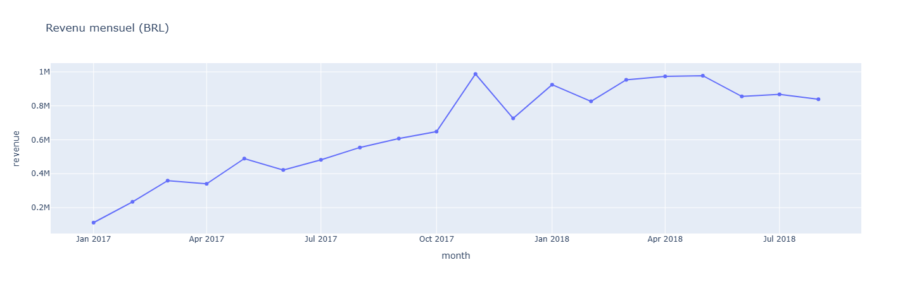

# E-Commerce Sales Analysis

Analyse des ventes du dataset Olist (Brazilian E-Commerce) avec Python, Pandas et Plotly.

**Dataset :** Kaggle, "Brazilian E-Commerce Public Dataset by Olist" (commandes livrées, janvier 2017 à août 2018).

## Indicateurs clés

| Indicateur | Valeur |
|---|---|
| Revenu total | 13 179 778 BRL |
| Commandes | 96 203 |
| Clients uniques | 93 096 |
| Panier moyen | 137,00 BRL |
| Clients récurrents | 3,0 % |
| Commandes livrées en retard | 8,0 % |

Le revenu correspond à la somme des prix des articles, hors frais de livraison.

## Questions analysées

1. Comment le revenu évolue-t-il dans le temps ?
2. Quelles catégories de produits génèrent le plus de revenu ?
3. Quels États brésiliens achètent le plus ?
4. Les retards de livraison influencent-ils les avis clients ?

## Principaux constats

**1. Forte croissance, puis plateau**
- Le revenu mensuel passe de 111 798 BRL (janvier 2017) à 973 534 BRL (avril 2018), soit **×8,7**.
- Pic en novembre 2017 : 987 648 BRL, soit **+52 %** par rapport à octobre (effet Black Friday).
- Décembre 2017 recule de **26 %** par rapport à novembre.
- En 2018, le revenu se stabilise entre environ 826 000 et 978 000 BRL par mois : la croissance s'arrête.

**2. Fidélisation très faible**
- Seulement **3,0 %** des clients commandent plus d'une fois.
- Hypothèse (non démontrée) : ce faible taux de réachat pourrait expliquer en partie le plateau de 2018.

**3. Le retard de livraison pénalise fortement les avis**
- Note moyenne : **4,30** pour les commandes livrées à l'heure contre **2,57** pour celles en retard, soit un écart de **1,73 point** sur 5.
- **8,0 %** des commandes sont livrées en retard.
- Attention : il s'agit d'une association observée. Un retard est une cause très plausible de la mauvaise note, mais l'analyse ne démontre pas la causalité.

**4. Catégories et États**
- Top 3 catégories : _à compléter avec les résultats du graphique_
- Top 3 États : _à compléter avec les résultats du graphique_

## Visualisations

## Limites

- Seules les commandes livrées sont analysées (une commande annulée ne génère pas de revenu).
- Les mois de 2016 et de fin 2018 sont exclus : trop peu de commandes pour être représentatifs.
- Le revenu exclut les frais de livraison, et aucun coût produit n'est disponible : ce n'est donc pas un profit.

## Pistes suivantes

- Segmentation clients RFM (récence, fréquence, montant).
- Modèle de machine learning pour prédire si une commande sera livrée en retard.

## Outils

Python, Pandas, NumPy, Plotly, Jupyter

## Lancer le projet

1. Télécharger le dataset sur Kaggle et placer les fichiers CSV dans un dossier `data/`.
2. Installer les dépendances : `pip install pandas numpy plotly jupyter`
3. Ouvrir `notebooks/analysis.ipynb` et exécuter les cellules dans l'ordre.